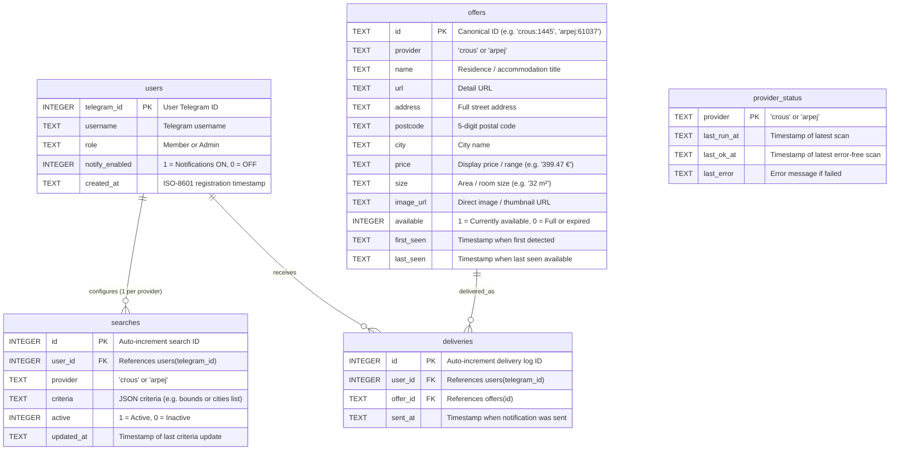

# Database Schema Documentation

This document describes the SQLite schema used in V2.

## Entity Relationship Diagram



## Table Breakdown & Purpose

### 1. `users` — Who is using the bot?
- **Purpose**: Stores authorized bot users after they register with `/register <password>`.
- **Key Fields**:
  - `telegram_id` (PK): The unique numeric ID from Telegram.
  - `role`: Either `'Member'` (standard user) or `'Admin'` (access to `/health`, status, admin commands).
  - `notify_enabled`: `1` if notifications are on, `0` if paused via `/toggle_notify` or settings.

---

### 2. `searches` — What is each user tracking?
- **Purpose**: Represents the saved filters/search configurations configured by a user.
- **Rules**:
  - `UNIQUE(user_id, provider)` ensures each user has **at most one** active CROUS search and **one** active ARPEJ search. Updating settings replaces the previous criteria instead of piling up duplicates.
- **Criteria JSON Examples**:
  - **CROUS**: `{"bounds": "2.224122_48.902156_2.4697602_48.8155755", "label": "Paris"}`
  - **ARPEJ**: `{"cities": ["paris", "palaiseau", "rennes"]}`

---

### 3. `offers` — What housing units have we discovered?
- **Purpose**: Canonical catalog of all accommodations seen across providers.
- **Key Fields**:
  - `id` (PK): Standardized as `provider:external_id` (e.g., `crous:1445` or `arpej:61037`).
  - `price`, `size`, `url`, `image_url`: Normalized data used to format Telegram message alerts.
  - `available`: `1` when currently open for booking, `0` when full or expired.
  - `first_seen` & `last_seen`: Tracks how fresh the offer is.

---

### 4. `deliveries` — Who received what, and when? (24h Cooldown)
- **Purpose**: History log of sent Telegram notifications.
- **The 24h Anti-Spam Rule**:
  - When the scanner finds a matching offer for a user, it checks if a delivery was recorded for `(user_id, offer_id)` in the last 24 hours.
  - If **yes** $\rightarrow$ skip sending (avoids pinging the user every scan interval for the same listing).
  - If **no** $\rightarrow$ send message and insert a new row with `datetime('now')`.

---

### 5. `provider_status` — Are scrapers healthy?
- **Purpose**: Operational dashboard for `/health`.
- **Key Fields**:
  - `provider`: `'crous'` or `'arpej'`.
  - `last_run_at`: Timestamp of the latest scan attempt.
  - `last_ok_at`: Timestamp of the latest scan that completed without errors.
  - `last_error`: The exception message if the scraper timed out or failed to reach the API.

## Key Rules & Architectural Decisions

1. **24-Hour Anti-Spam Notification Rule**:
   - `deliveries` is an append-only log.
   - When an offer matches a user's search, we query:
     ```sql
     SELECT 1 FROM deliveries
     WHERE user_id = ? AND offer_id = ?
     AND sent_at > datetime('now', '-24 hours')
     LIMIT 1;
     ```
   - If a delivery was sent in the last 24h, it is suppressed to prevent spamming the user across frequent scan intervals.

2. **Per-User Provider Search Isolation**:
   - `UNIQUE (user_id, provider)` in `searches` guarantees a user has at most one saved search for CROUS and one for ARPEJ. Updating criteria replaces the existing search profile.

3. **Provider Error Isolation**:
   - `provider_status` records the health of each provider independently. If one provider times out or fails to parse, it records `last_error` while allowing other providers to complete normally.
